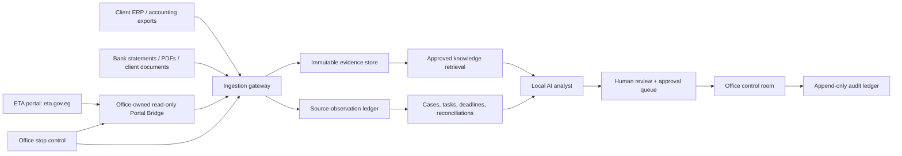

# SAPAuto V8 — Plan 2.3: Production Office Intelligence Platform

## 1. Decision and purpose

Build SAPAuto into a single, office-owned operating system for a large Egyptian accounting and tax firm. It must safely observe the work of **300+ companies**, turn verified government and accounting facts into cases and deadlines, and help accountants prepare work without ever inventing tax facts or acting without authority.

This is a delivery plan, not permission to begin live automated access, submit any tax action, or use a cloud AI service.

### 1.1 Product promise

The product is an **AI secretary and control room**, not an autonomous tax practitioner:

1. It watches approved sources continuously.
2. It preserves the original source evidence and every data version.
3. It highlights what requires human attention, in the order it matters.
4. It drafts, explains, reconciles, and checks—but does not make a tax filing, payment, acknowledgement, or legal conclusion on its own.
5. A responsible person must approve every consequential output and all external actions.

### 1.2 Production definition

“Production-ready” means more than a running dashboard. It means the firm can prove, for every company and every alert:

- where the information came from;
- when it was seen and by which connector;
- whether it is a source fact, an accounting calculation, an AI suggestion, or a human decision;
- who reviewed it and what they approved;
- what the system did not know; and
- that no unapproved action was sent to ETA, a client, or a bank.

No milestone may claim production readiness until these properties are tested with real authorised data.

---

## 2. Operating principles — the non-negotiable rules

| Rule | Required behaviour |
| --- | --- |
| Evidence first | Every displayed tax fact links to its immutable source record, screenshot/export, API response, or uploaded document. |
| Source is not opinion | Portal/API values remain immutable observations. Local review status, accountant notes, and AI analysis are separate fields. |
| Unknown stays unknown | Missing deadline, amount, status, or document identity is shown as unknown and creates a triage task; it is never guessed. |
| Human authority | Only assigned authorised roles may approve advice, client communications, submissions, or payment instructions. |
| Read before write | Every integration starts read-only. Write capability is a separate project with signed approval, two-person controls, and a kill switch. |
| Tenant/company isolation | A company’s credentials, data, evidence, embeddings, and AI context cannot be visible to another company. |
| Least privilege | Each agent and user receives only the source access and action scope required. |
| No silent automation | Every scan, retry, failure, skipped account, and stop command becomes an auditable event. |
| Local-first confidentiality | Taxpayer documents and prompts remain local by default. Any cloud-model use is opt-in, redacted, and logged. |
| Truth over polish | The application must prefer an honest incomplete record to a confident-looking but unverified answer. |

---

## 3. System boundaries and trusted data sources

### 3.1 Source hierarchy

The platform must label data by source and trust level:

1. **ETA portal (`eta.gov.eg`)** — the current primary source. A customer-owned, read-only local bridge observes only the authorised portal views, captures retained evidence, and emits normalized observations. It never becomes the sole legal source of truth.
2. **Client accounting system** — approved ERP/accounting exports or APIs, with a mapping contract and reconciliation reports.
3. **Human-uploaded evidence** — bank statements, contracts, PDFs, correspondence, and internal schedules. These require document classification and reviewer confirmation before they influence a deadline or tax conclusion.
4. **AI output** — always advisory and never promoted to a source fact.

**Explicitly out of scope for this plan:** ETA e-invoice/e-receipt API integration. It may be assessed in a future, separate plan only if the firm chooses to add it.

### 3.2 Source registry

Create a maintained registry containing, for every source:

- legal/operational owner;
- integration method and read/write scope;
- data classes received;
- polling or notification cadence;
- authentication/storage method;
- source freshness target;
- known limitations and failure modes;
- evidence retention period; and
- the accountable partner who accepts the source for production use.

### 3.3 No unverified legal knowledge base

Egyptian tax/accounting guidance is time-sensitive. The knowledge base must contain only:

- official ETA guidance, SDK documentation, published decisions, and official forms;
- laws and executive regulations from authoritative government sources;
- firm-approved internal policy, clearly marked as internal guidance; and
- dated professional analysis reviewed and approved by a named senior tax professional.

Every knowledge item requires a source link/file, publication date, effective-from date, language, subject, reviewer, review date, and expiry/review date. The AI may cite only retrieved items and must state when the retrieval set does not establish an answer.

---

## 4. Target architecture

### 4.1 Components

| Component | Responsibility | May do | Must never do |
| --- | --- | --- | --- |
| Local Portal Bridge | Per-company portal observation | Login under authorised local session; read approved screens; capture evidence; emit normalized events | Send forms, download via an unverified state-changing click, change portal state, share browser tokens |
| ETA Portal Bridge | Portal-based document, obligation, payment, and profile observation | Read authorised screens; validate normalized observations; retain evidence | Submit, cancel, reject, acknowledge, or change portal state |
| Ingestion gateway | Validate and normalize inputs | Schema validation, deduplication, versioning, encryption, evidence hashes | Alter raw source values or silently discard anomalies |
| Case engine | Operational workflow | Open cases/tasks, calculate approved deadlines, route escalation | Invent a deadline or close a case without a recorded resolution |
| Reconciliation engine | Compare sources | Detect discrepancies and build review queues | Decide a tax position automatically |
| Local AI analyst | Summarise, extract, classify, draft, flag risk | Explain source-backed information with citations | Give unqualified tax advice, change status, access secrets, submit anything |
| Approval service | Human control | Enforce authority, separation of duties, expiry, signatures | Let an AI approve its own work |
| Control room | Admin/accountant interface | Show full names, evidence, workload, status, confidence, and action history | Hide uncertainty or replace source evidence with prose |

---

## 5. Data model and evidence model

### 5.1 Required entities

- `company`: stable internal ID, verified legal name, tax registration number where authorised, source provenance, status, account owner.
- `source_account`: connector identity and encrypted credential reference; credentials are never stored in event payloads or logs.
- `source_document`: immutable raw observation with version, source identifier, retrieval time, content hash, parsed fields, and evidence reference.
- `obligation`: source-backed potential obligation with status, deadline source, confidence, and review status.
- `payment_observation`: source amount/currency/date/status kept separately from local review, settlement evidence, and accountant conclusion.
- `case`: operational container linking company, documents, obligations, risks, tasks, and communications.
- `task`: owner, deadline, authoritative deadline basis, escalation policy, completion evidence.
- `reconciliation`: source systems compared, matching method, difference, materiality, and reviewer decision.
- `ai_analysis`: model/provider, prompt/evidence references, output, confidence, limitations, reviewer status, and expiry.
- `approval`: approver, scope, decision, reason, evidence, timestamp, and expiration.
- `audit_event`: append-only actor/action/object/time/outcome/correlation ID.

### 5.2 Four data lanes in every screen

Every result must visibly distinguish:

1. **Official/source observation** — exactly what was retrieved.
2. **Office record** — accountant-entered classification, note, assignment, and local review status.
3. **AI analysis** — advisory text, citations, confidence, and limitations.
4. **Approved conclusion/action** — named human approval and evidence.

This separation prevents the most dangerous failure: an AI or office user overwriting the original government record.

### 5.3 Identity protection

- Never derive a legal company name from a username or account identifier.
- Use the verified portal profile/header value or an approved manual mapping.
- Show the full legal name without clamping, ellipsis, arbitrary shortening, or model rewriting.
- Preserve the original spelling and keep aliases in a separate searchable field.
- Present a “name conflict” case whenever authoritative sources disagree.

---

## 6. AI operating design

### 6.1 Roles

| AI role | Engine | Allowed work | Human checkpoint |
| --- | --- | --- | --- |
| Local confidential analyst | Firm-hosted model (for example Gemma-class) | Extraction, Arabic/English summaries, classification suggestions, document comparison, task drafts | Accountant accepts/rejects any outcome that affects a case |
| Knowledge-grounded tax assistant | Local retrieval + approved knowledge corpus | Explain requirements, identify missing evidence, quote/cite approved materials, draft client question lists | Senior tax reviewer approves advice or external communication |
| Mistral cloud reviewer (optional) | Mistral API only with per-workspace cloud consent | Second opinion on redacted, minimum-necessary material | No client/company data unless explicit policy permits; never an action authority |
| OpenCode engineering adviser | OpenCode, isolated from production data | Code review, test plans, migrations, architecture advice | Change-control approval and test gate before deployment |

### 6.2 Mandatory AI answer format

Every substantive AI answer must contain:

1. Direct answer or “I cannot determine this from the available evidence.”
2. Facts used, each linked to source/evidence.
3. Interpretation and assumptions, separately labeled.
4. Missing facts and required human checks.
5. Suggested next task—not an autonomous action.
6. Confidence expressed as evidence coverage, not invented numerical certainty.

The model must never shorten legally material names, document IDs, monetary amounts, dates, legal references, or quotation excerpts needed for review.

### 6.3 AI prohibitions

The AI must not:

- submit, sign, cancel, reject, pay, acknowledge, or send tax/financial communications;
- alter source fields, deadlines, or evidence;
- state that a payment or filing is complete without supporting evidence;
- provide an uncited legal/tax conclusion as fact;
- access passwords, browser cookies, OTP/MFA values, private keys, or unrelated company data;
- use cloud APIs outside documented consent and redaction policy; or
- approve its own analysis.

### 6.4 Evaluation before live use

Build a firm-owned evaluation set of anonymised, reviewed real cases. Measure:

- extraction accuracy by field;
- Arabic and bilingual document handling;
- missed-deadline and false-deadline rate;
- citation correctness and evidence coverage;
- incorrect certainty rate;
- cross-company data leakage attempts;
- prompt-injection resistance from portal/PDF text; and
- reviewer agreement versus senior tax/accounting staff.

Any high-severity hallucination, missing deadline, confidentiality leak, or unsupported tax claim blocks deployment of that AI function.

---

## 7. 24/7 operating model

### 7.1 What “24/7” means

The service runs continuously, but not uncontrolled:

- Read-only portal polling uses approved per-account schedules, backoff, and rate limits.
- The local bridge runs only on an authorised office device/session and obeys office hours, load limits, MFA requirements, and stop controls.
- The dashboard displays freshness per company/source, not a misleading single “online” label.
- A missed scan becomes an explicit incident—not a silent gap.

### 7.2 Scan states

`not_configured → ready → queued → scanning → evidence_received → reconciled → review_required → healthy`

Exceptional states:

`auth_required`, `rate_limited`, `source_changed`, `evidence_incomplete`, `failed`, `parked`, `stop_pending`, `stop_unconfirmed`, `stopped`.

No state may be skipped. “Healthy” means only that the agreed read checks completed; it never means there are no tax liabilities.

### 7.3 Safety controls

- office-wide emergency stop with local-agent acknowledgement;
- per-company pause;
- rate limits and concurrency caps;
- isolated browser context per company;
- no overlapping cycles;
- immutable run manifest with exact account count and fingerprint;
- retries only for read-safe operations;
- dead-letter queue for parsing/connector failures;
- automatic alert for expired credentials, stale sources, unexpected UI/schema change, or a rising failure rate;
- daily encrypted backups and restore drill; and
- an on-call escalation path owned by the firm.

---

## 8. Accountant workflow

### 8.1 Morning control room

The home view answers these questions in one screen:

- What requires attention today, ordered by deadline/risk and evidence freshness?
- Which companies were not scanned, why, and since when?
- Which government source changes do not match the ERP or office record?
- Which payments, filings, notices, or client questions need a named owner?
- Which conclusions are waiting for partner approval?

### 8.2 Company dossier

Each company page contains:

- full verified legal name and identity provenance;
- connector/source health and freshness;
- current obligations and deadlines with basis;
- payments, source observations, and separate local review;
- government documents and evidence timeline;
- ERP reconciliation status;
- open cases, tasks, owners, and escalations;
- approved tax knowledge relevant to the case;
- AI suggestions with evidence/citations; and
- immutable activity/audit history.

### 8.3 Case lifecycle

`detected → triaged → assigned → evidence_requested → analysis_drafted → reviewer_checked → approved_action_ready → completed / escalated / disputed`

Only a human may move a case into `approved_action_ready` or `completed`. Each transition records a reason and evidence.

### 8.4 Escalation rules

- A deadline without a basis stays `deadline_unknown` and is escalated to the responsible manager.
- An ETA/ERP mismatch above a firm-defined materiality threshold creates a reconciliation case.
- A stale source or failed scan never clears prior risk; it raises a data-freshness incident.
- An AI high-risk flag routes to a human reviewer, not a client or government endpoint.
- Any missing approval at deadline creates a visible partner escalation.

---

## 9. Security, privacy, and compliance design

### 9.1 Secrets and access

- Move all credentials from text files into an encrypted secrets vault or OS-protected credential store.
- Never log passwords, API keys, tokens, OTPs, raw authorization headers, or plaintext taxpayer credentials.
- Rotate exposed credentials immediately and maintain a rotation register.
- Require MFA for administrators and privileged approvals.
- Use role-based access plus company-level assignment and database row-level isolation.
- Separate development, test, staging, and production credentials and databases.

### 9.2 Data protection

- Encrypt data in transit and at rest.
- Encrypt evidence objects with per-tenant/company envelope keys where practical.
- Store hashes and retention policy with every source file.
- Use redacted datasets for AI evaluation and engineering.
- Do not place sensitive data in browser telemetry, third-party logs, screenshots, or error trackers.
- Give the firm a retention/deletion policy reviewed by its legal/compliance owner.

### 9.3 Change control

Every production change needs:

1. issue/risk statement;
2. peer review (OpenCode can advise but cannot approve);
3. automated tests;
4. staging verification with non-production or expressly authorised test data;
5. rollback plan;
6. named deployment approver; and
7. post-deploy monitoring window.

---

## 10. Delivery roadmap

### Phase A — Production foundation (weeks 1–3)

**Goal:** establish safe identity, evidence, secrets, auditing, and deployment before scale.

- Create production/staging environments, backups, monitoring, and restoration drill.
- Replace plaintext account storage with a secure credential-reference model.
- Finalise company identity registry and import all 300+ companies with provenance and owner.
- Enforce immutable source observations, local-review separation, and append-only audit events.
- Implement source registry and data-classification policy.
- Freeze portal bridge to read-only mode.

**Exit:** restore drill succeeds; security review has no plaintext secrets; every company has a stable identity and assigned operational owner.

### Phase B — ETA portal bridge proof and ingestion (weeks 3–6)

**Goal:** establish real-data pathways one source at a time.

- Complete a written, supervised ETA portal safety study for every interaction the bridge may perform.
- Configure the read-only ETA portal bridge for a small authorised pilot set; retain its browser/session boundary on the office machine.
- Run one low-risk company through read-only evidence collection, then 10, then a controlled cohort.
- Validate source schemas, Arabic numeral handling, full-name capture, evidence hashing, and idempotent re-ingestion.

**Exit:** all pilot data items reconcile to retained evidence; no write occurs; controlled failure handling works; named partner accepts connector scope.

### Phase C — Accountant workspace and reconciliation (weeks 5–9)

**Goal:** turn facts into managed work.

- Deliver company dossier, global attention queue, cases, tasks, deadline basis, payment reconciliation, and reports.
- Integrate approved ERP/accounting data source(s) with reconciliation rules reviewed by accountants.
- Configure materiality thresholds and escalation rules by service line.
- Run parallel with existing office processes for a fixed period; compare misses, delays, and false alerts.

**Exit:** accountants can complete a full day’s work from the system while parallel controls show no missed material item.

### Phase D — AI copilot (weeks 8–12)

**Goal:** make AI useful without making it an authority.

- Deploy local model/runtime in the firm environment.
- Build approved knowledge ingestion, retrieval, citations, prompt-injection defenses, and evaluation set.
- Enable extraction, bilingual summaries, missing-evidence checklists, and task drafts.
- Start optional cloud review only after written data-sharing approval and redaction verification.
- Measure errors and reviewer acceptance; disable any capability that misses critical issues.

**Exit:** defined quality thresholds are met on held-out cases; every AI output is evidence-linked and reviewable; no AI external action exists.

### Phase E — Scale to 300+ companies (weeks 12–16)

**Goal:** reliable continuous operations at firm scale.

- Onboard companies in controlled batches with manifest, baseline, and owner sign-off.
- Enable scheduling with bounded concurrency and per-source limits.
- Build health/freshness dashboards, incident response, on-call process, and capacity testing.
- Conduct disaster-recovery test and security penetration review.

**Exit:** sustained operation meets agreed freshness targets, exception handling, and restore objectives across the full authorised company list.

### Phase F — Optional controlled write programme (later, separate approval)

No write action is included in Plan 2.3. A future programme may consider limited submissions only after legal, technical, insurance, partner, and client-authority review. It requires maker-checker approval, explicit preview, signed evidence, idempotency, reconciliation, and immediate rollback/stop controls.

---

## 11. Required tests and production gates

### 11.1 Automated tests

- unit tests for parsing, Arabic/English numerals, date/amount extraction, identity, deduplication, and deadline rules;
- contract tests for the portal-normalization event schema and captured evidence;
- integration tests with fixtures and sandbox/test systems where ETA provides them;
- browser bridge tests that prove no unintended click/download/write action;
- end-to-end tests for evidence → case → task → approval → audit;
- permission/isolation tests across companies;
- security tests for secret redaction and audit immutability;
- AI evaluation, citation, and prompt-injection tests;
- load tests for 300+ company manifests and scheduled work; and
- backup/restore and incident-recovery drills.

### 11.2 Human acceptance gates

| Gate | Must be approved by |
| --- | --- |
| Source and data scope | Engagement partner + technology owner |
| Tax deadline/reconciliation rules | Named senior tax/accounting reviewer |
| API/portal connector transition to read-only production | Partner + security owner |
| AI knowledge base and answer policy | Senior tax reviewer + privacy owner |
| Each new batch of companies | Assigned service leader |
| Any write capability | Separate executive/legal/client-authority approval |

### 11.3 Production readiness scorecard

The system may be called production-ready only when all are true:

- 100% of active companies have verified identity, owner, and source configuration.
- Every source observation has evidence, hash, timestamp, and provenance.
- The service achieves the agreed freshness SLA over a sustained pilot period.
- Failed/parked/stale accounts visibly escalate and are never reported as clear.
- Reconciliation exceptions are reviewed within the agreed timeframe.
- No P0/P1 security, data-integrity, or AI-evidence defect remains open.
- Recovery drill, audit sampling, and access review pass.
- The responsible partners sign the operating and incident procedures.

---

## 12. Immediate next decisions

Before engineering work begins, the firm must decide and record:

1. Which 10 low-risk companies form the first authorised pilot?
2. Which exact ETA portal pages, document families, and account views are authorised for the read-only bridge?
3. Which ERP/accounting products and exports are in scope first?
4. Who is the accountable tax reviewer, accounting reviewer, security owner, and incident owner?
5. What freshness target applies to each source (real-time notification, hourly, daily)?
6. What materiality thresholds and deadline escalation rules does the firm approve?
7. What information is allowed to leave the firm for optional cloud AI review, if any?
8. What retention, backup, and client-consent requirements apply?
9. What is the firm’s formal definition of an approved client communication or tax action?

---

## 13. First build slice

Start with **one narrow, real-data, read-only slice**:

> For one authorised company, retrieve an approved ETA source using the safest verified integration available; store immutable evidence; show the full verified company identity; create a review case only when facts support it; let a local AI produce a cited summary; require accountant acceptance; and produce a complete audit trail.

Do not expand to additional sources, companies, or autonomous capabilities until this slice passes technical tests, accountant review, security review, and the partner acceptance gate.

## 14. Final position

This plan builds an exceptionally capable system, but it deliberately refuses the illusion of an autonomous tax expert. Its power comes from continuously collecting authorised evidence, making work visible, applying approved controls consistently, and giving qualified accountants a trustworthy, cited assistant. That is the only safe route to earning the firm’s trust at 300+ company scale.
